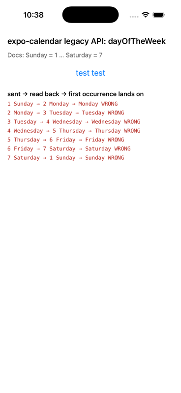

# expo-calendar: `dayOfTheWeek` is stored one weekday late on iOS (legacy API)

Reproduction for https://github.com/expo/expo/issues/52319 with the legacy `expo-calendar/legacy`
functions. The class-based twin of this repo is
https://github.com/dileepapeiris/expo-calendar-weekday-class-repro.

Versions: Expo SDK 58, `expo-calendar` 58.0.6, React Native 0.88, iOS 26.5 simulator (iPhone 17).

## Run

```sh
npm install
npx expo run:ios      # development build, iOS simulator
```

Grant calendar access when asked. The check runs on launch, the **test test** button runs it again.

## What the app does

For every value of the documented `DayOfTheWeek` enum (`Sunday = 1` … `Saturday = 7`) it

1. calls `createEventAsync` with a weekly `recurrenceRule` whose `daysOfTheWeek` is that value,
   starting on Sunday 11/01/26,
2. reads the event back with `getEventAsync` and prints `daysOfTheWeek[0].dayOfTheWeek`,
3. lists the following week (Mon 11/02 … Sun 11/08) with `getEventsAsync` and prints the weekday the
   single occurrence lands on,
4. deletes the event again.

## Result



| sent (docs) | read back | occurrence lands on |
| --- | --- | --- |
| 1 Sunday | 2 Monday | Monday |
| 2 Monday | 3 Tuesday | Tuesday |
| 3 Tuesday | 4 Wednesday | Wednesday |
| 4 Wednesday | 5 Thursday | Thursday |
| 5 Thursday | 6 Friday | Friday |
| 6 Friday | 7 Saturday | Saturday |
| 7 Saturday | 1 Sunday | Sunday |

Every value is shifted by one day. The read-back value and the real occurrence agree with each other,
so the rule is stored on the wrong weekday; this is not only a display problem.

## Cause

`packages/expo-calendar/ios/Records/RecurrenceRuleRecords.swift` declares the input enum as
`monday = 1 … sunday = 7` and maps each case by name to `EKWeekday`. The TypeScript enum, the docs
and `EKWeekday` itself use `sunday = 1 … saturday = 7`, and the read path returns the `EKWeekday`
raw value. So the integer `2` (Monday in the docs) becomes `.tuesday` on the way in and comes back
as `3`. Both the legacy and the class-based API go through the same `createRecurrenceRule` helper.
Android is not affected: its RRULE builder does not support `daysOfTheWeek`.
